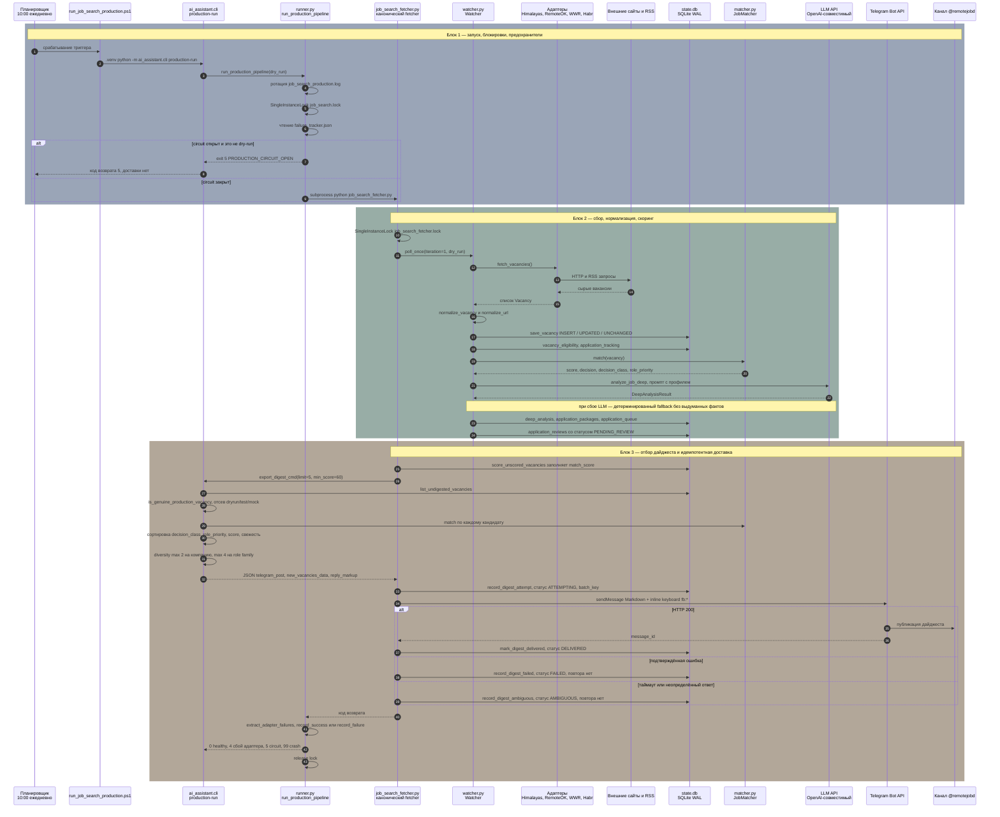
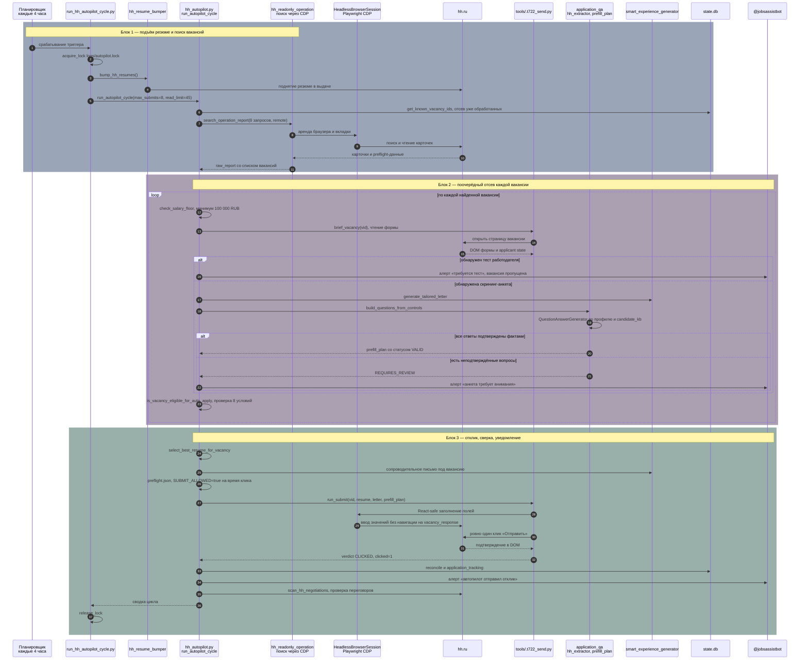
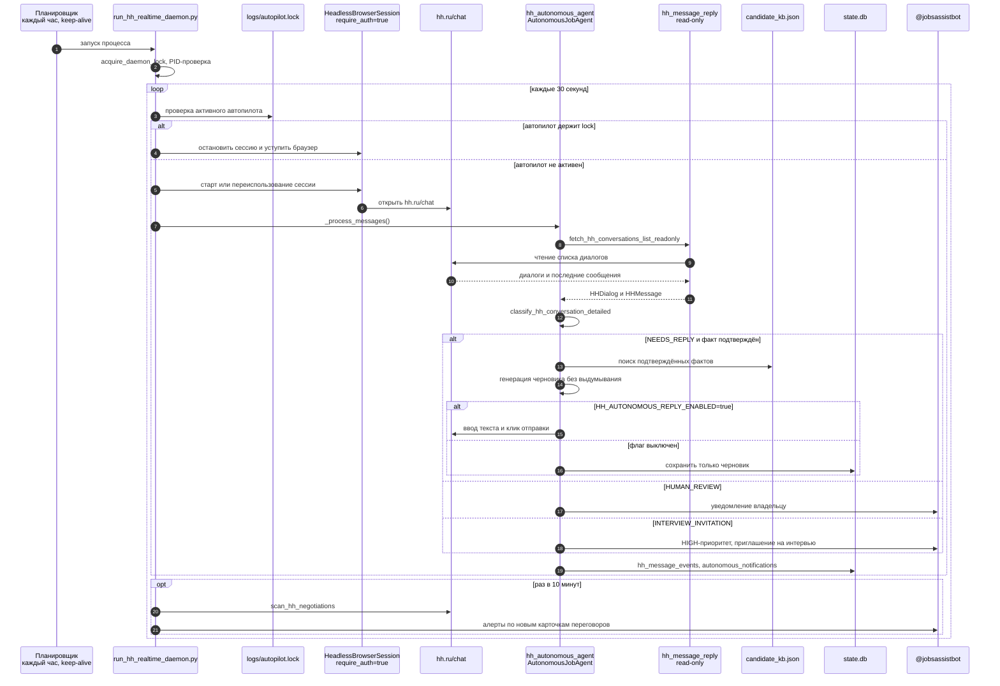
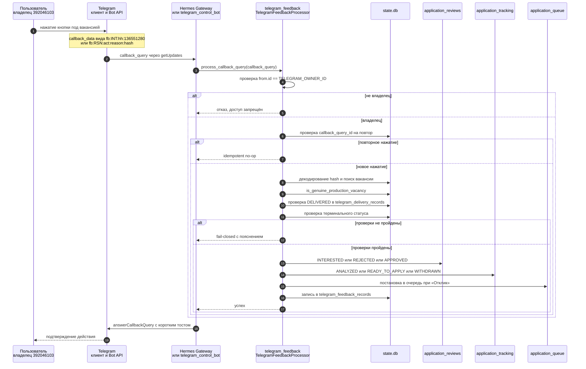
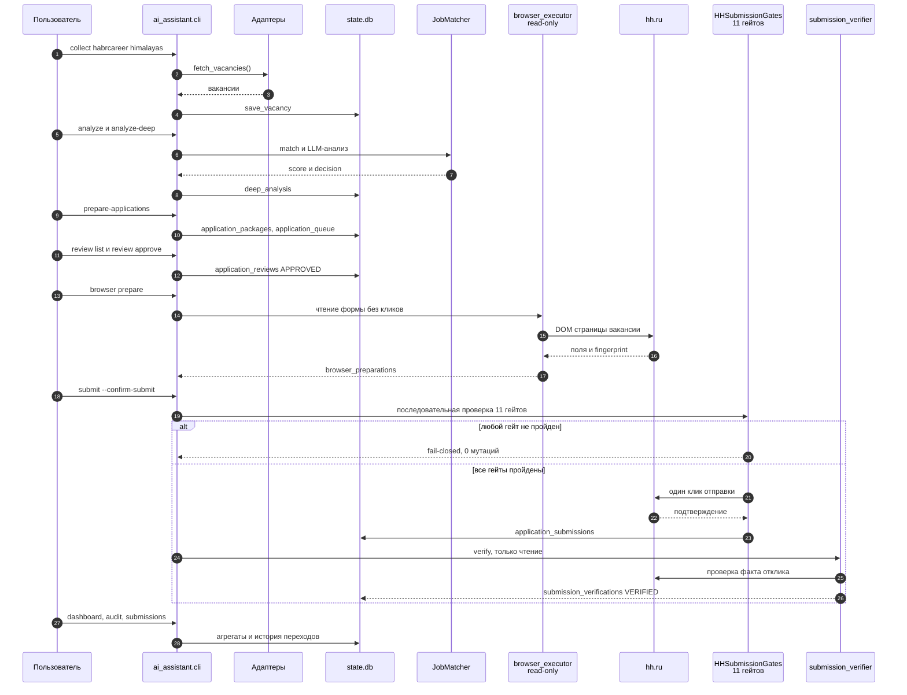
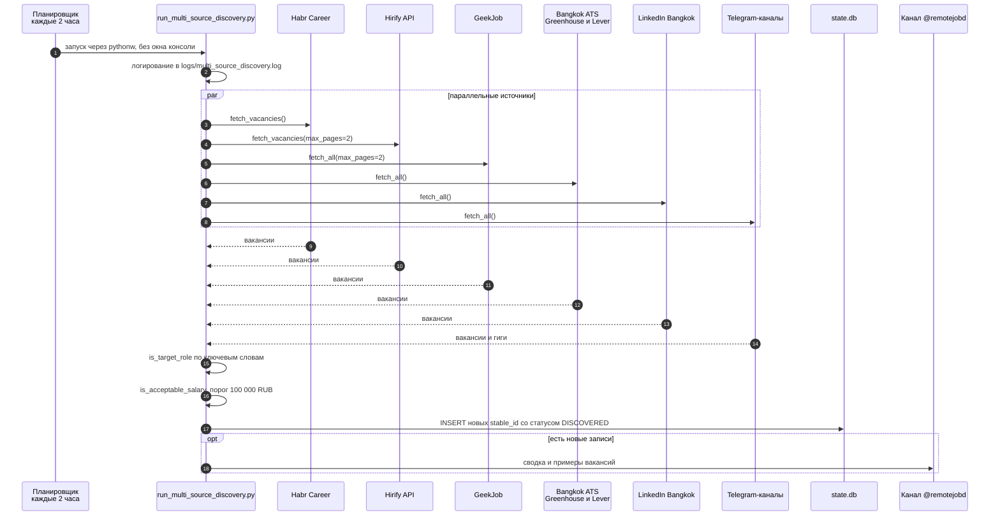
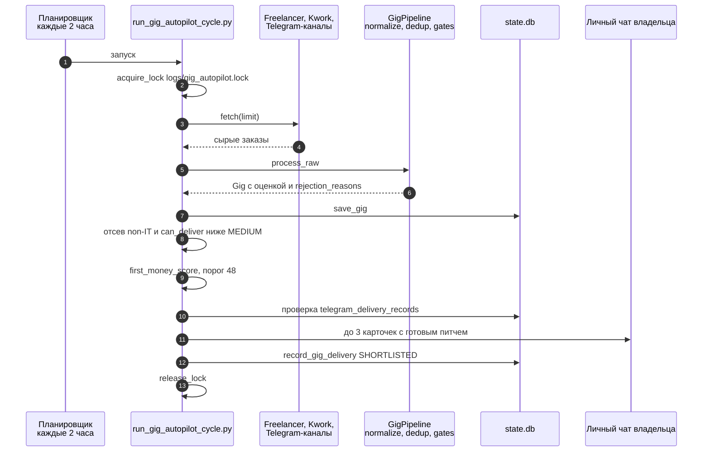

# Архитектура проекта job-search

## 1. Что это

Персональная система автоматизации поиска работы: собирает удалённые вакансии и
проектные заказы, нормализует и дедуплицирует их, оценивает по профилю кандидата
(`candidate_profile.json`), готовит пакет отклика (резюме + сопроводительное
письмо + ответы на скрининг), ведёт жизненный цикл отклика в SQLite и доставляет
дайджест в Telegram. Всё, что касается внешних действий (браузер, HH, почта),
закрыто предохранителями: по умолчанию режим REVIEW, AUTO включается только
явными kill-switch-ами, факты никогда не выдумываются.

Ключевая идея: **один канонический конвейер** (`adapters → normalizer → matcher →
state.db → digest`) и **несколько независимых точек входа** (ежедневный дайджест,
HH-автопилот, realtime-демон сообщений, Telegram-пульт, ручной CLI).

## 2. Стек

| Слой | Технологии |
|------|------------|
| Язык / среда | Python 3.11, venv `.venv`, Windows 11 + Task Scheduler |
| Данные | SQLite (`state.db`, WAL), JSON-файлы профиля и артефактов |
| Сеть | `requests`, `urllib`, `feedparser` (RSS), Telegram Bot API |
| LLM | `openai`-совместимый клиент (`LLM_API_KEY` / `LLM_BASE_URL` / `LLM_MODEL`) + детерминированный offline-fallback |
| Браузер | Playwright / headless Chrome, raw-CDP через `websockets` |
| Веб-UI | FastAPI + uvicorn (`ai_assistant/ui/app.py`, команда `cli ui`) |
| Тесты | pytest, ~1400 offline-тестов, сокеты и urllib заблокированы фикстурой |
| Конфиг | `.env` + `ai_assistant/config.py` (kill-switch `SUBMIT_ALLOWED` читается до `load_dotenv`) |

## 3. Карта модулей

### Сбор и оценка
| Модуль | Роль |
|--------|------|
| `ai_assistant/adapters/*` | Himalayas, RemoteOK, WeWorkRemotely, Habr Career (RSS/HTTP) |
| `scripts/run_multi_source_discovery.py` | Дополнительные источники: Hirify, GeekJob, Bangkok ATS, LinkedIn Bangkok, Telegram-каналы |
| `ai_assistant/normalizer.py` | Приведение сырых записей к схеме `Vacancy` |
| `ai_assistant/vacancy_identity.py` | Канонический ID, алиасы, дедупликация |
| `ai_assistant/eligibility.py` | Гео/remote-допустимость вакансии |
| `ai_assistant/remote_filter.py` | Строгая проверка «100% remote» |
| `ai_assistant/matcher.py` | `JobMatcher`: жёсткие ограничения + взвешенный скор, `decision_class`, `role_priority` |
| `ai_assistant/job_analyzer.py` | Глубокий LLM-анализ + fallback без выдумывания фактов |
| `ai_assistant/watcher.py` | Один цикл конвейера до ворот human review (сам не отправляет) |

### Подготовка отклика
| Модуль | Роль |
|--------|------|
| `application_prep.py` | Пакет отклика: адаптация резюме + письмо |
| `application_qa.py` | Truth-only ответы на скрининг, валидация |
| `application_queue.py` | Приоритетная очередь |
| `application_review.py` | Запись ревью и статусы |
| `hh_extractor.py`, `prefill_plan.py`, `prefill_execute.py` | Извлечение формы HH и React-safe заполнение |
| `hh_submission.py` | 11 жёстких гейтов + один клик отправки |
| `hh_application_runner.py` | Ручной прогон `next --confirm-submit` |

### HH-автономность
| Модуль | Роль |
|--------|------|
| `hh_autopilot.py` | Цикл: поиск → бриф → скрининг → отклик → сверка |
| `hh_autonomous_agent.py` | Агент полного цикла + обработка входящих диалогов |
| `hh_message_reply.py` | Read-only чтение диалогов, truth-only черновики |
| `hh_message_watcher.py` | Наблюдение за новыми сообщениями |
| `hh_browser_provider.py`, `hh_browser_launcher.py` | Headless-сессия, CDP, проверка авторизации |
| `hh_chat_monitor.py` | Скан переговоров и алерты |
| `hh_resume_bumper.py` | Поднятие резюме в выдаче HH |

### Доставка и обратная связь
| Модуль | Роль |
|--------|------|
| `cli.py` | Единая точка входа, `export_digest_cmd`, `production-*` |
| `integrations/hermes/job_search_fetcher.py` | Канонический fetcher + диспетчер дайджеста |
| `telegram_notifier.py` | Текст дайджеста + inline-клавиатура `fb:*` |
| `telegram_feedback.py` | Обработка callback-кнопок, provenance, идемпотентность |
| `telegram_control_bot.py` | Пульт `@jobsassistbot`, long-polling |
| `runner.py` | Лок, ротация логов, circuit breaker, маскировка секретов |

## 4. Хранилища

`state.db` (SQLite, WAL) — единственный источник правды:

- `vacancies` — канонические вакансии, `match_score`, `match_decision`
- `deep_analysis`, `application_packages`, `application_queue`, `application_reviews`
- `application_tracking`, `application_status_history` — жизненный цикл
- `vacancy_eligibility`, `canonical_vacancies`, `vacancy_aliases` — гео и дедуп
- `application_submissions`, `submission_verifications`, `submission_claims`
- `hh_applications`, `hh_application_transitions`, `hh_questionnaires`, `hh_message_events`
- `telegram_delivery_records` — идемпотентность доставки
- `telegram_feedback_records` — аудит нажатий кнопок
- `autonomous_cycle_runs`, `autonomous_notifications`, `interview_events`

Файлы: `candidate_profile.json`, `candidate_kb.json`, `resume.md`,
`vacancies.json` (legacy-снимок), `logs/`, `artifacts/`, `tools/.t722*/`.

## 5. Точки входа и расписание

| Задача планировщика | Период | Скрипт | Итог |
|---|---|---|---|
| `JobSearch_Daily_Digest` (+ Hermes cron) | ежедневно 10:00 | `scripts/run_job_search_production.ps1` | дайджест в `@remotejobd` |
| `JobSearch_HH_Autopilot` | каждые 4 часа | `scripts/run_hh_autopilot_cycle.py` | отклики на HH + алерты |
| `JobSearch_HH_Realtime` | каждые 30 с (демон) | `scripts/run_hh_realtime_daemon.py` | автоответы на сообщения |
| `JobSearch_MultiSource` | каждые 2 часа | `scripts/run_multi_source_discovery.py` | пополнение `state.db` |
| `JobSearch_Telegram_Bot` | long-polling | `ai_assistant/telegram_control_bot.py` | пульт управления |
| `JobSearch_Gig_Autopilot` | каждые 2 часа | `scripts/run_gig_autopilot_cycle.py` | карточки заказов (см. §12) |

---

## 6. Поток A — ежедневный производственный дайджест

Самый важный и самый защищённый путь: сбор → скоринг → отбор → идемпотентная
доставка в канал.

---

## 7. Поток B — HH Autopilot: поиск, скрининг, отклик

Отдельная ветка, работающая через живую сессию браузера. В отличие от потока A,
здесь есть реальный клик «Отправить» — он выполняется под постоянной
авторизацией владельца, а не под per-vacancy подтверждением (см. §14).

---

## 8. Поток C — realtime-демон сообщений HH

---

## 9. Поток D — обратная связь из Telegram-дайджеста

Важно: кнопка «📄 Отклик» **не отправляет** заявку. Она переводит запись в
`READY_TO_APPLY` и ставит её в очередь; отправка остаётся за потоком B или E.

---

## 10. Поток E — ручной human-in-the-loop через CLI

11 гейтов: `SUBMIT_ALLOWED`, `REVIEW_APPROVED`, `FINGERPRINT_MATCH`,
`URL_DOMAIN`, `VACANCY_MATCH`, `PROFILE_LOADED`, `COVER_LETTER_READY`,
`NO_UNKNOWN_QUESTIONS`, `NOT_ALREADY_APPLIED`, `NO_PREVIOUS_SUBMISSION_ATTEMPT`,
`HUMAN_CONFIRMED`.

---

## 11. Поток F — мультиисточниковый сбор (каждые 2 часа)

Этот поток только пополняет базу. Отбор и доставку дайджеста делает поток A,
поэтому дубли в канал не попадают.

---

## 12. Поток G — гиг-автопилот (деградировавший)

Статус: пакет `ai_assistant/gig/*` и `ai_assistant/gig_pitch_generator.py`
отсутствуют в рабочем дереве (остались только `__pycache__` и тесты в
`tests/gig/`), поэтому на 2026-10-18 скрипт падает на импорте. Поток описан по
коду и тестам, но фактически не работает.

---

## 13. Инварианты безопасности

- **Truth-only**: любой отсутствующий факт ведёт в `HUMAN_REVIEW`, а не к догадке.
- **Fail-closed**: сомнение блокирует действие, число мутаций — ноль.
- **Один отклик на вакансию**: дедуп по `stable_id` + `submission_claims`.
- **Никаких повторов после неопределённого исхода**: `AMBIGUOUS` требует ручного
  разбора через `digest-attempts recover` или `submissions recover`.
- **Запрет навигации** на `applicant/vacancy_response`: захват только на уже
  открытой вкладке пользователя.
- **REVIEW по умолчанию** для сообщений; AUTO требует kill-switch, allowlist и
  неизменного fingerprint.
- **Почта**: отправка физически отсутствует в коде, только read-only Gmail.
- **Circuit breaker**: 3 подряд живых сбоя → exit 5, снимается только
  `production-control resume`.

## 14. Наблюдения и расхождения (для супервизора)

1. **Документация и код расходятся по автономной отправке.** README и
   `PROJECT_STATE.md` заявляют «prepare-only, отправка только с
   `--confirm-submit`». Фактически `hh_autopilot.submit_vacancy()` сам выставляет
   `SUBMIT_ALLOWED=true` и кликает отправку, а `preflight.json` пишет
   `auto_submit_authorized: true` без `human_confirmed`. Поток B описан по коду.
2. **Отсутствующие модули.** `ai_assistant/hh_readonly_operation.py` и
   `ai_assistant/hh_browser_lease.py` не найдены ни на диске, ни в git. Их
   импортируют `hh_autopilot.run_autopilot_cycle` и
   `run_hh_autopilot_cycle.py`, поэтому поиск вакансий и уступка браузера
   реально падают, а исключение глушится в `{"status": "ERROR"}`.
3. **Два планировщика на один fetcher.** Задача Windows и Hermes cron приходят
   в один и тот же файл; взаимное исключение держится на отдельном
   `job_search_fetcher.lock`, иначе был бы `database is locked`.
4. **Легаси-данные в отборе.** `vacancies_json:*` и тестовые фикстуры
   отсекаются `is_genuine_production_vacancy`, но остаются в базе и влияют на
   агрегаты дашборда.
5. **Дублирование кода отправки.** `run_multi_source_discovery.py` и
   `hh_autopilot.py` шлют в Telegram напрямую через `urllib`, минуя
   `TelegramNotifier`, поэтому у них нет общей идемпотентности и ретрай-политики.
