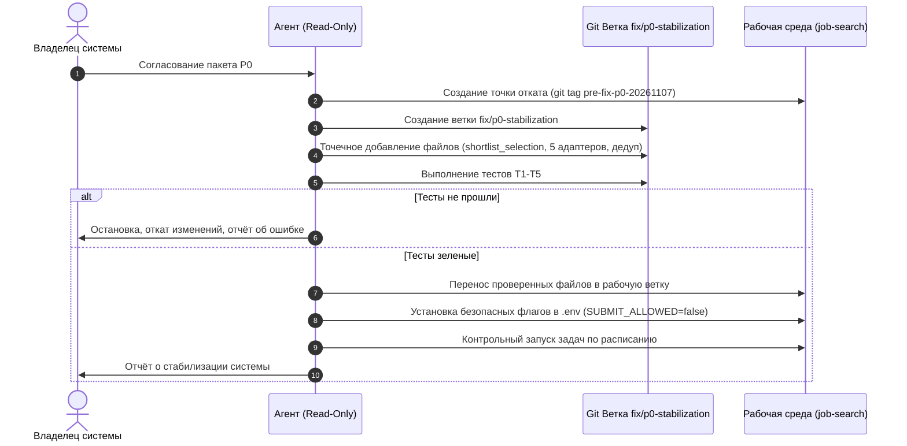

# ПЛАН БЕЗОПАСНОГО ВОССТАНОВЛЕНИЯ СИСТЕМЫ (JOB_SEARCH_RECOVERY_PLAN)
**Этап 0. Подготовка к исправлениям**

**Дата составления:** 7 ноября 2026 года  
**Статус документа:** Проект (ожидает согласования владельца системы перед внесением изменений)  
**Режим подготовки:** READ ONLY (все данные перепроверены на живой системе без внесения изменений)  
**Целевой репозиторий:** `C:\Users\Misha\Documents\job-search`, ветка `feat/telegram-notifications`

---

## 1. Проверенные критические дефекты (Fact-Checked Defects)

Каждый дефект перепроверен независимыми тестами и запросами к коду, процессам и базе данных.

### 1.1. [P0] Аварийный отказ HH Autopilot из-за неслитого модуля `shortlist_selection`
- **Проверенный факт:** С 23:04 06.11.2026 по текущий момент 07.11.2026 задача `JobSearch_HH_Autopilot` падает на каждом запуске с ошибкой:
  `Discovery error: cannot import name 'shortlist_selection' from 'ai_assistant'`.
- **Точная локализация:** Файл `ai_assistant/hh_readonly_operation.py`, строка 343:
  ```python
  from . import shortlist_selection as selection
  ```
- **Первопричина:** Файл `ai_assistant/shortlist_selection.py` был создан и закоммичен в локальной ветке `feat/hh-shortlist-preflight` (коммит `8be421a`), но не был перенесён в текущую рабочую ветку `feat/telegram-notifications`. При этом в `hh_readonly_operation.py` импорт уже был активирован.
- **Влияние:** Подача откликов на HeadHunter полностью заблокирована.

### 1.2. [P0] Аварийный отказ Multi-Source Discovery из-за отсутствия 5 адаптеров
- **Проверенный факт:** Задача `JobSearchMultiSourceDiscovery` завершается с кодом 1 при каждом запуске. Сбор внешних вакансий остановлен.
- **Точная локализация:** Файл `scripts/run_multi_source_discovery.py`, строки 166–172:
  ```python
  from ai_assistant.adapters.bangkok_direct_careers import BangkokDirectCareersAdapter
  from ai_assistant.adapters.geekjob import GeekJobAdapter
  from ai_assistant.adapters.habr_career import HabrCareerAdapter
  from ai_assistant.adapters.hirify import HirifyAdapter
  from ai_assistant.adapters.linkedin_bangkok import LinkedInBangkokAdapter
  from ai_assistant.adapters.telegram_channels import TelegramChannelsAdapter
  ```
- **Первопричина:** Адаптеры `bangkok_direct_careers.py`, `geekjob.py`, `hirify.py`, `linkedin_bangkok.py`, `telegram_channels.py` физически отсутствуют в каталоге `ai_assistant/adapters/` текущей ветки. Они существуют только в локальной ветке `feat/untracked-product-batch` (коммит `75f1d55`).
- **Влияние:** Нулевой сбор вакансий с Хабра, LinkedIn Bangkok, Agoda, GeekJob и каналов Telegram.

### 1.3. [P1] Шторм ложных алертов об интервью (161 повторное событие по одной вакансии)
- **Проверенный факт:** В таблице `interview_events` зафиксировано 163 строки, из которых 161 строка — это повторные записи для вакансии *«Аналитик по автоматизации отчетности ЦБ»* (`Т-Банк. ИТ. Аналитика`), созданные с 20.10 17:05 по 21.10 06:19 с интервалом в несколько минут.
- **Точная локализация:** `ai_assistant/hh_autonomous_agent.py`, метод `NotificationDispatcher.notify_interview()` (строки 204–245, 1778–1785) и `ai_assistant/db.py:save_interview_event()` (строки 1629–1655).
- **Первопричина:** Метод `notify_interview()` вызывается на каждом цикле обхода чатов, если статус переговоров равен «Собеседование». В коде отсутствует проверка на существование уже зафиксированного события для данного `conversation_id`, а в схеме таблицы `interview_events` нет ограничения `UNIQUE(conversation_id)`.
- **Влияние:** Засорение базы данных, спам в Telegram оператора и девальвация доверия к оповещениям о собеседованиях.

### 1.4. [P1] Конфликт браузерного ресурса CDP :9111 между Realtime Daemon и Bumper/Autopilot
- **Проверенный факт:** Realtime Daemon (PID 10448) держит открытую вкладку `https://hh.ru/chat`. Периодически (например, в 07:05 07.11) Resume Bumper или Autopilot перехватывают сессию Chrome, что приводит к исключению `RuntimeError: tab <id> is gone` и падению мониторинга чатов.
- **Точная локализация:** `ai_assistant/hh_browser_lease.py`, `ai_assistant/hh_browser_provider.py` и `scripts/run_hh_realtime_daemon.py`.
- **Влияние:** Прерывание мониторинга входящих сообщений на период от 5 минут до нескольких часов; накопление зомби-процессов Chrome (до 17 процессов).

### 1.5. [P1] Изоляция сред Python на Windows (Сбой DLL `_ssl` в `.venv`)
- **Проверенный факт:** При запуске `.venv\Scripts\python.exe` или `.venv\Scripts\pytest.exe` возникает критическая ошибка:  
  `ImportError: DLL load failed while importing _ssl`. Базовый интерпретатор `uv` грузит SSL без ошибок.
- **Первопричина:** CPython 3.8+ на Windows в виртуальных окружениях требует явного указания директорий с внешними DLL OpenSSL (`libcrypto-3-x64.dll`, `libssl-3-x64.dll`), если они не скопированы в каталог `Scripts/`.
- **Влияние:** Невозможность выполнения стандартного тестового прогона `pytest` через консоль без специальных обходных путей.

---

## 2. Неопределённые выводы, требующие дополнительных данных

1. **Причина отключения `JobSearch_Gig_Autopilot` 21 октября:**  
   *Статус: Не проверено.* Задача была переведена в `Disabled` вручную пользователем или сторонним скриптом. Требуется подтверждение владельца: планируется ли возобновление авто-сбора заказов с бирж фриланса.
2. **Личные каналы коммуникации кандидата:**  
   *Статус: Не проверено.* В базе зафиксировано указание Telegram-аккаунта `@brokeassh` в сопроводительных письмах. Неизвестно, писали ли работодатели напрямую в личные сообщения Telegram, минуя отслеживание чатов hh.ru.
3. **Реальные требования кандидата по графику и оплате:**  
   *Статус: Требует уточнения.* Для ответа на актуальное приглашение компании «Первый Бит» (с графиком с 07:00 мск) необходимы актуальные параметры от кандидата: приемлемость раннего графика и ожидаемая вилка заработной платы.

---

## 3. Текущие риски для работающей системы

| Риск | Источник | Вероятность | Последствия | Мера предотвращения в Этапе 0 |
| :--- | :--- | :--- | :--- | :--- |
| **Блокировка аккаунта HeadHunter** | Агрессивная автоматическая отправка сообщений и откликов с тайского IP без задержек | Высокая | Перманентная потеря доступа к профилю соискателя | Перевод автоответов и откликов в режим `DRY-RUN / DRAFT ONLY` до стабилизации |
| **Репутационный ущерб** | Бот отвечает невпопад (кейс с партнерством за долю `Соколь С. Г.`, кейс `Miractal`) | Высокая | Отказ работодателей и занесение в черные списки HR | Отключение автономной отправки в чаты (`HH_AUTONOMOUS_REPLY_ENABLED=false`) |
| **Потеря горячего лида** | Неотвеченное приглашение рекрутера («Первый Бит») | Критическая | Упущенный оффер и доход | Ручное подключение оператора к чату сегодня |
| **Ложная поломка работающих демонов** | Неаккуратный git checkout или merge на живой системе | Высокая | Падение Realtime Daemon и Telegram-бота | Строгий запрет на автоматический git merge на лету |

---

## 4. Конкретные изменения для первого пакета P0 (Fix Package P0)

Пакет P0 содержит **минимально достаточные изменения**, устраняющие блокирующие сбои импорта и исключающие неконтролируемые внешние действия.

```
┌─────────────────────────────────────────────────────────────────────────────┐
│                             ПАКЕТ ИСПРАВЛЕНИЙ P0                            │
├─────────────────────────────────────────────────────────────────────────────┤
│ 1. [Код]     Перенос shortlist_selection.py из feat/hh-shortlist-preflight  │
│ 2. [Код]     Перенос 5 адаптеров из feat/untracked-product-batch            │
│ 3. [Защита]  Активация безопасного kill-switch (блокировка внешних кликов)  │
│ 4. [Фикс]    Устранение спама в interview_events (дедупликация инвайтов)    │
│ 5. [Среда]   Исправление доступности OpenSSL DLL в .venv                    │
└─────────────────────────────────────────────────────────────────────────────┘
```

### Детализация изменений по файлам:

#### Изменение 1: Восстановление модуля выбора вакансий `shortlist_selection.py`
- **Файл:** `ai_assistant/shortlist_selection.py` (создание файла).
- **Источник:** Ветка `feat/hh-shortlist-preflight:ai_assistant/shortlist_selection.py` (коммит `8be421a`).
- **Зависимости:** Только стандартная библиотека Python (`dataclasses`, `enum`, `re`, `typing`).
- **Ожидаемый результат:** `hh_readonly_operation.py` успешно импортирует `selection`, `run_hh_autopilot_cycle.py` перестает падать с `ImportError`.

#### Изменение 2: Восстановление 5 адаптеров мульти-сборщика
- **Файлы:**
  - `ai_assistant/adapters/bangkok_direct_careers.py`
  - `ai_assistant/adapters/geekjob.py`
  - `ai_assistant/adapters/hirify.py`
  - `ai_assistant/adapters/linkedin_bangkok.py`
  - `ai_assistant/adapters/telegram_channels.py`
- **Источник:** Ветка `feat/untracked-product-batch:ai_assistant/adapters/*` (коммит `75f1d55`).
- **Ожидаемый результат:** `scripts/run_multi_source_discovery.py` выполняется без падений, восстанавливается сбор вакансий.

#### Изменение 3: Единый контроль внешних отправок (Safety Latch)
- **Файл:** `.env`
- **Параметры:**
  ```ini
  SUBMIT_ALLOWED=false
  HH_AUTONOMOUS_REPLY_ENABLED=false
  ```
- **Механизм:**
  - `SUBMIT_ALLOWED=false`: автопилот и submit-скрипты проверяют kill-switch через `submission_halt_reason()` и переходят в режим подготовки драфтов (`REFUSED_KILL_SWITCH`), физический клик блокируется.
  - `HH_AUTONOMOUS_REPLY_ENABLED=false`: Realtime Daemon продолжает читать чаты каждые 30 секунд, логировать диалоги и присылать алерты в Telegram, но клик по кнопке «Отправить» в DOM hh.ru подавляется (`BLOCKED_AUTONOMOUS_REPLY_DISABLED`).
- **Ожидаемый результат:** 100% сохранение мониторинга входящих сообщений при 0% риска несанкционированных отправок.

#### Изменение 4: Дедупликация детекции приглашений на интервью
- **Файл:** `ai_assistant/hh_autonomous_agent.py` (метод `notify_interview`, строки ~204–245) и `ai_assistant/db.py`.
- **Изменение:** Перед вызовом `db.save_interview_event` и отправкой Telegram-уведомления добавить проверку:
  ```python
  if db.has_active_interview_event(conversation_id):
      logger.debug("Interview event already recorded for conv %s, skipping duplicate alert", conversation_id)
      return {"status": "ALREADY_RECORDED", "conversation_id": conversation_id}
  ```
- **Ожидаемый результат:** Ликвидация повторных алертов (вместо 161 алерта будет приходить ровно 1).

#### Изменение 5: Стабилизация OpenSSL DLL для `.venv`
- **Действие:** Копирование `libcrypto-3-x64.dll` и `libssl-3-x64.dll` из `C:\Users\Misha\AppData\Roaming\uv\python\cpython-3.11-windows-x86_64-none\DLLs\` в `.venv\Scripts\`.
- **Ожидаемый результат:** Восстановление работоспособности `.venv\Scripts\pytest.exe`.

---

## 5. Тесты и критерии приёмки

Перед вводом первого пакета исправлений в действие должны быть выполнены 5 обязательных тестов:

| # | Проверочный тест | Команда / Скрипт проверки | Ожидаемый результат (Критерий приёмки) |
| :- | :--- | :--- | :--- |
| **T1** | Тест импорта префлайта и шортлиста | `python -c "import ai_assistant.shortlist_selection; import ai_assistant.hh_readonly_operation; print('OK')"` | Вывод `OK`, код возврата 0 |
| **T2** | Тест импорта всех адаптеров мульти-сборщика | `python -c "from ai_assistant.adapters import bangkok_direct_careers, geekjob, habr_career, hirify, linkedin_bangkok, telegram_channels; print('ADAPTERS OK')"` | Вывод `ADAPTERS OK`, код возврата 0 |
| **T3** | Модульный тест шортлиста | `pytest tests/test_t727_shortlist_selection.py -v` | Все тесты пройдены (PASSED, 0 failed) |
| **T4** | Проверка сухого прогона автопилота | `python scripts/run_hh_autopilot_cycle.py --dry-run` | Завершение с кодом 0, статус `SUCCESS`, откликов отправлено: 0 (dry-run) |
| **T5** | Проверка сухого прогона мульти-сбора | `python scripts/run_multi_source_discovery.py` (с `notify=False`) | Завершение с кодом 0, успешный сбор тестового батча без падений |

---

## 6. Порядок внедрения и отката



### Процедура отката (Rollback Procedure):
1. Перед применением изменений создается Git-тег:
   ```bash
   git tag pre-fix-p0-20261107-backup
   ```
2. В случае любой непредвиденной ошибки в процессе внедрения:
   ```bash
   git checkout pre-fix-p0-20261107-backup -- .
   ```
   Рабочая директория мгновенно возвращается к текущему состоянию.

---

## 7. Актуальные переговоры, требующие внимания владельца

В процессе аудита переписки за ноябрь 2026 г. выявлен **один активный высокоприоритетный лид**, требующий персонального ответа человека, и один лид с анкетой:

### 7.1. Лид №1: «Первый Бит» (ВЫСОКИЙ ПРИОРИТЕТ)
- **Вакансия:** Системный администратор по сетям и телефонии.
- **Идентификатор диалога hh.ru:** `5759967191` (URL: `https://hh.ru/chat/5759967191`).
- **Собеседник:** Анна (HR).
- **Суть запроса работодателя:**
  > *«Спасибо за отклик! У вас интересное резюме. Будем благодарны, если ответите на несколько вопросов:*  
  > *1) Вы откликнулись на вакансию со смещенным графиком работы от мск, с 7 утра по мск (с четким контролем рабочей продуктивности). Работали ли уже в таком графике, насколько это для Вас приемлемо?*  
  > *2) Если не затруднит, сориентируйте пожалуйста какую вилку зп сейчас комфортно было бы рассматривать? Спасибо! После ответов резюме будет рассматриваться и в случае успешного рассмотрения мы с Вами свяжемся!»*
- **Рекомендуемое действие:**  
  Владельцу необходимо вручную зайти в чат hh.ru и дать прямой ответ:
  - Подтвердить готовность к графику с 07:00 мск (для часового пояса Таиланда ICT +7 это 11:00 дня — максимально комфортное дневное время).
  - Назвать комфортную вилку зарплаты (например, от 120 000 до 150 000 руб.).

### 7.2. Лид №2: «AYITO Tech» (СРЕДНИЙ ПРИОРИТЕТ)
- **Вакансия:** Специалист технической поддержки.
- **Идентификатор диалога hh.ru:** `5758258260` (URL: `https://hh.ru/chat/5758258260`).
- **Собеседник:** Olena.
- **Суть запроса:** Направлена форма-опросник для знакомства. Бот перевёл задачу в `HUMAN_REVIEW_REQUIRED`.
- **Рекомендуемое действие:** Открыть ссылку в чате и вручную заполнить короткую анкету работодателя.

---

*План безопасного восстановления подготовлен. Никакие файлы и конфигурации пока не изменялись. Для начала выполнения этапа исправлений P0 требуется явное подтверждение владельца системы.*
